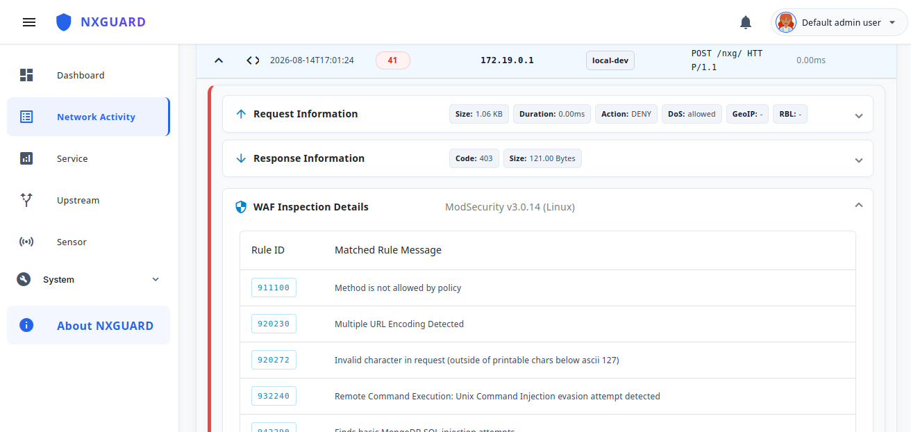
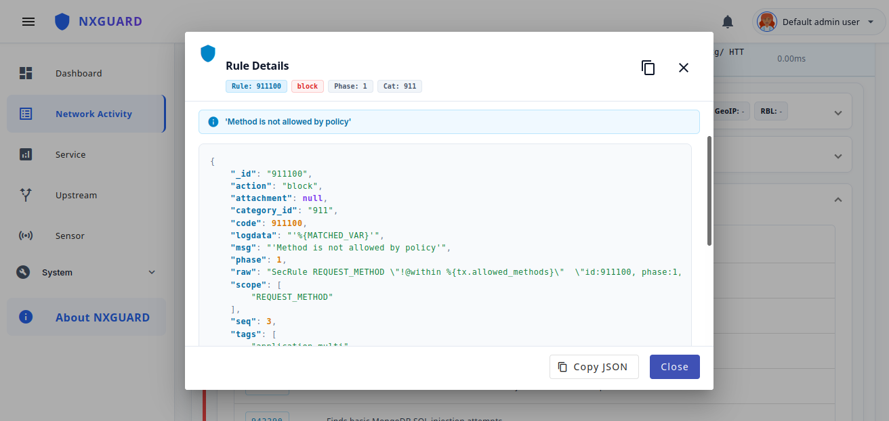

#  NXGuard

**NXGuard** is a high-performance API gateway and reverse proxy built on **NGINX**, **OpenResty modules**, and
**ModSecurity**. It provides a security layer for API ecosystems, with a focus on scalability and operational
simplicity.

[](https://opensource.org/licenses/Apache-2.0)

[](https://github.com/sponsors/liberatti)

---

## 🚀 Key Features

- **🛡️ Advanced Security:** Integrates natively with **ModSecurity v3** for real-time threat detection, including SQL injection and cross-site scripting.
- **⚡ High Performance:** Uses **NGINX with OpenResty modules and Lua** for sub-millisecond request processing.
- **📊 Real-Time Monitoring:** Provides detailed transaction logs and telemetry to help identify threats proactively.
- **⚖️ Smart Load Balancing:** Distributes traffic across backend services.
- **🛠️ Operational Simplicity:** Combines a lightweight architecture with a modern management interface.
- **🌐 Scalability:** Uses a modular design that supports horizontal scaling in containerized environments.

---

## 📸 Screenshots & UI Preview

### Dashboard

*A modern management interface for controlling your API security.*

### Transaction Monitoring

*Real-time transaction logging and traffic inspection.*

### Request & Rule Inspection

*Detailed inspection of raw requests and responses.*


*Detailed ModSecurity rule matches and trigger analysis.*

---

## 🏗️ Architecture


*An architecture that integrates NGINX, OpenResty modules & Lua, ModSecurity, and IPXA.*

---

## 🚦 Getting Started

### Quick Start with Docker Compose

Deploy the full NXGuard stack, including the management interface and IPXA:

```yaml
services:
  nxguard:
    image: liberatti/nxguard:latest
    environment:
      NXGUARD_ROLE: "main"
      SERVERID: "nxguard-admin"
    ports:
      - 5000:5000
      - 80:80
      - 443:443
    deploy:
      resources:
        limits:
          memory: 256M

  ipxa:
    image: liberatti/ipxa:latest
    volumes:
      - ipxa_data:/opt/ipxa/data
    deploy:
      resources:
        limits:
          memory: 64M
      replicas: 2

volumes:
  ipxa_data:
```

- **Management Interface:** [http://localhost:5000](http://localhost:5000)
- **Default Credentials:** `admin@nxguard.local` / `admin`

---

## 🧪 Security Validation

Validate your WAF rules with **GoTestWAF**:

```bash
docker run --rm \
  --shm-size=2g \
  --add-host nxguard.local:host-gateway \
  -v ${PWD}/.github/pages/src/assets/reports:/app/reports \
  wallarm/gotestwaf \
#  --testSet=false-pos \
  --addDebugHeader \
  --url=https://localhost:8443/ipxa/ \
  --blockStatusCodes=403 \
  --reportFormat=html \
  --noEmailReport
  --nonBlockedAsPassed
```


*A GoTestWAF report showing request blocking and alert results.*

```yaml
inspection:
    score:
        inbound: 5
        outbound: 10
    level: 3
```

---

## 🔢 WAF Rule ID Ranges

| Range                     | Description                |
|:--------------------------|:---------------------------|
| **1-99,999**              | Local/internal use |
| **100,000-199,999**        | Oracle published rules |
| **200,000-299,999**        | Comodo published rules |
| **300,000-399,999**        | GotRoot.com rules |
| **900,000-999,999**        | OWASP Core Rule Set (CRS) |
| **900,501-900,599**        | NXGuard exclusion lists |
| **2,000,000-2,999,999**    | Trustwave SpiderLabs rules |

---

## 📡 Telemetry Notice

To improve its security engine, NXGuard collects anonymous traffic statistics in 24-hour cycles. **It does not collect
sensitive, personal, or request-specific data.** This information is used solely to improve threat detection accuracy.

---

## 📄 License

This project is licensed under the **Apache License 2.0**. See [LICENSE](LICENSE) for the full license text.

---
Developed with ❤️ by **Gustavo Liberatti**