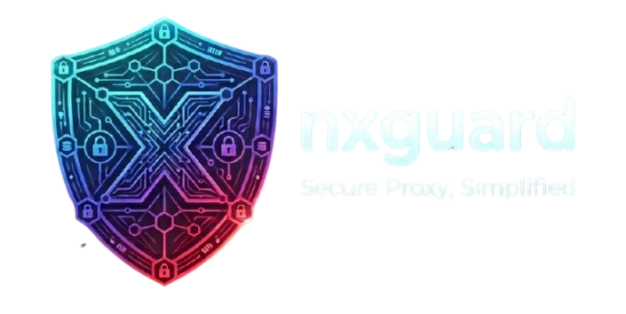
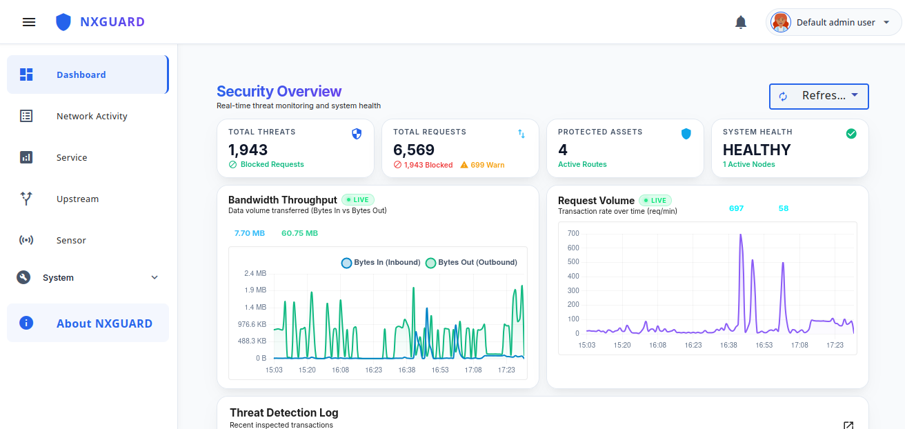
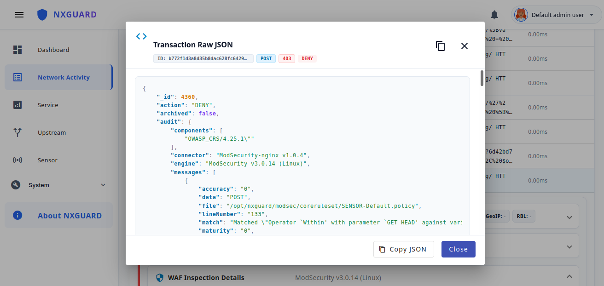
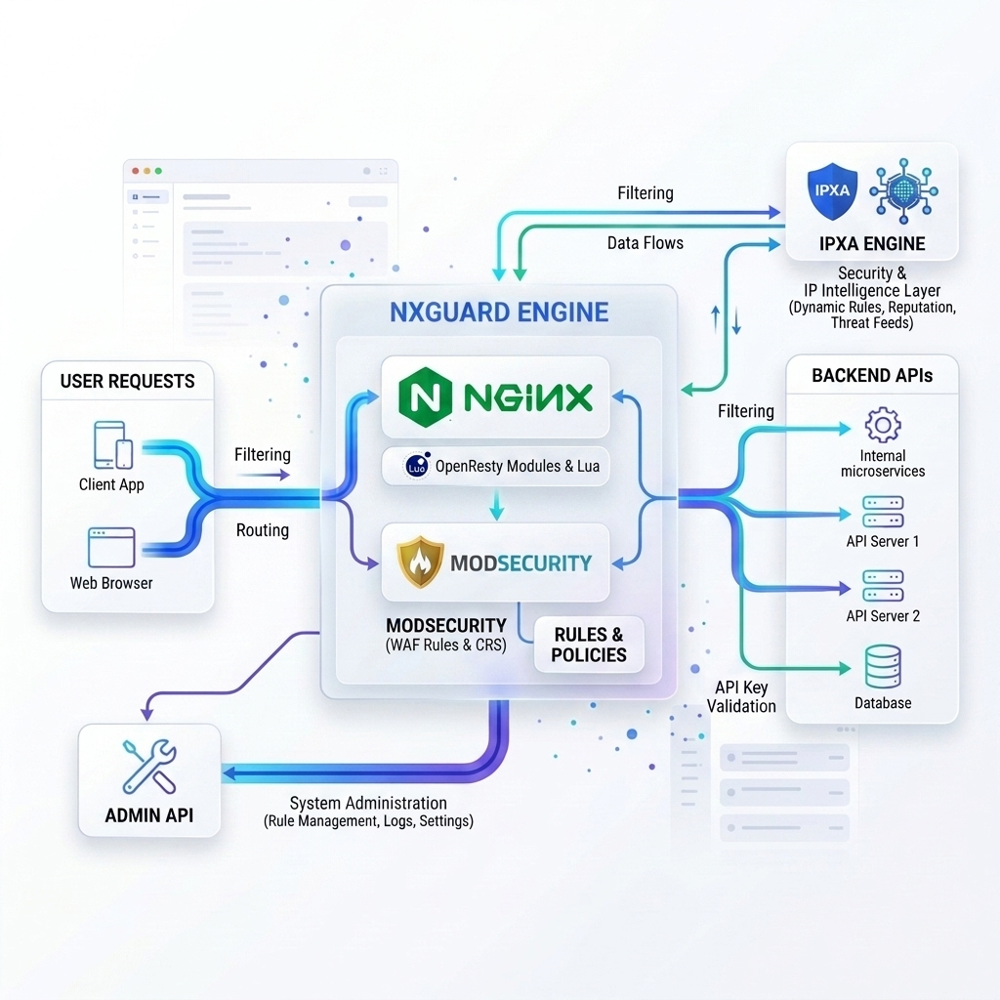
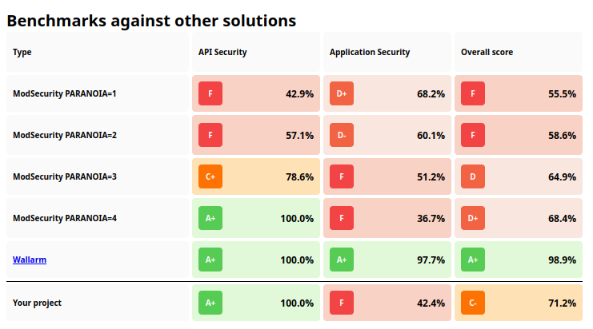
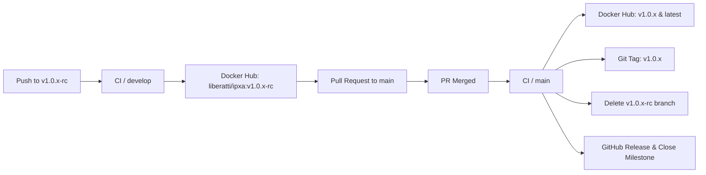

#  NXGuard

**NXGuard** is a high-performance API gateway and reverse proxy built on **NGINX**, **OpenResty modules**, and
**ModSecurity**. It provides a security layer for API ecosystems, with a focus on scalability and operational
simplicity.

[](https://opensource.org/licenses/Apache-2.0)

[](https://github.com/sponsors/liberatti)

---

## 🚀 Key Features

- **🛡️ Advanced Security:** Integrates natively with **ModSecurity v3** for real-time threat detection, including SQL injection and cross-site scripting.
- **⚡ High Performance:** Uses **NGINX with OpenResty modules and Lua** for sub-millisecond request processing.
- **📊 Real-Time Monitoring:** Provides detailed transaction logs and telemetry to help identify threats proactively.
- **⚖️ Smart Load Balancing:** Distributes traffic across backend services.
- **🛠️ Operational Simplicity:** Combines a lightweight architecture with a modern management interface.
- **🌐 Scalability:** Uses a modular design that supports horizontal scaling in containerized environments.

---

## 📸 Screenshots & UI Preview

### Dashboard

*A modern management interface for controlling your API security.*

### Transaction Monitoring

*Real-time transaction logging and traffic inspection.*

### Request & Rule Inspection

*Detailed inspection of raw requests and responses.*


*Detailed ModSecurity rule matches and trigger analysis.*

---

## 🏗️ Architecture


*An architecture that integrates NGINX, OpenResty modules & Lua, ModSecurity, and IPXA.*

---

## 🚦 Getting Started

### Quick Start with Docker Compose

Deploy the full NXGuard stack, including the management interface and IPXA:

```yaml
services:
  nxguard:
    image: liberatti/nxguard:latest
    environment:
      NXGUARD_ROLE: "main"
      SERVERID: "nxguard-admin"
    ports:
      - 5000:5000
      - 80:80
      - 443:443
    deploy:
      resources:
        limits:
          memory: 256M

  ipxa:
    image: liberatti/ipxa:latest
    volumes:
      - ipxa_data:/opt/ipxa/data
    deploy:
      resources:
        limits:
          memory: 64M
      replicas: 2

volumes:
  ipxa_data:
```

- **Management Interface:** [http://localhost:5000](http://localhost:5000)
- **Default Credentials:** `admin@nxguard.local` / `admin`

---

## 🧪 Security Validation

Validate your WAF rules with **GoTestWAF**:

```bash
docker run --rm \
  --shm-size=2g \
  --add-host nxguard.local:host-gateway \
  -v ${PWD}/.github/pages/src/assets/reports:/app/reports \
  wallarm/gotestwaf \
#  --testSet=false-pos \
  --addDebugHeader \
  --url=https://localhost:8443/ipxa/ \
  --blockStatusCodes=403 \
  --reportFormat=html \
  --noEmailReport
  --nonBlockedAsPassed
```



*A GoTestWAF report showing request blocking and alert results.*

```yaml
inspection:
    score:
        inbound: 5
        outbound: 10
    level: 3
```

---

## 🔢 WAF Rule ID Ranges

| Range                     | Description                |
|:--------------------------|:---------------------------|
| **1-99,999**              | Local/internal use |
| **100,000-199,999**        | Oracle published rules |
| **200,000-299,999**        | Comodo published rules |
| **300,000-399,999**        | GotRoot.com rules |
| **900,000-999,999**        | OWASP Core Rule Set (CRS) |
| **900,501-900,599**        | NXGuard exclusion lists |
| **2,000,000-2,999,999**    | Trustwave SpiderLabs rules |

---


## 🔄 Release & CI/CD Workflow

IPXA follows an automated release lifecycle managed by GitHub Actions workflows:



### 1. Push to Release Candidate Branch (`v1.0.x-rc` / `v*-fix`)

When committing and pushing to a release candidate branch (e.g., `v1.0.11-rc` or `v*-fix`):
- **Code Check & Lint**: Runs code quality checks (`flake8`) and security validation.
- **Multi-Architecture Build**: Builds Docker images across `linux/amd64` and `linux/arm64`.
- **Pre-Release Docker Image**: Generates and pushes the multi-arch manifest to Docker Hub tagged with the branch name:
  ```bash
  docker pull liberatti/ipxa:v1.0.x-rc
  ```
- **Production Safety**: The `latest` tag is **not** modified during candidate branch builds.

### 2. Merge Pull Request to `main`

When a Pull Request from a `v1.0.x-rc` (or `v*-fix`) branch is merged into `main`:
- **Version Resolution**: Automatically extracts the release version from the source branch (e.g., `v1.0.11-rc` &rarr; `v1.0.11`).
- **Production Docker Images**: Builds and pushes the multi-arch image to Docker Hub under two tags:
  * `liberatti/ipxa:v1.0.x` (e.g., `liberatti/ipxa:v1.0.11`)
  * `liberatti/ipxa:latest`
- **Git Tagging**: Automatically creates and pushes the release tag `v1.0.x` to the repository.
- **Branch Cleanup**: Automatically deletes the merged source branch (`v1.0.x-rc`) from the remote repository.
- **GitHub Release & Milestone**: Compiles release notes from merged PRs and closed issues, attaches the release notes, publishes the GitHub Release, and closes the corresponding milestone.


---

## ⚖️ Limitation of Liability

**Disclaimer of Warranty**: This software is provided "AS IS", without warranty of any kind, express or implied. The author(s) and contributor(s) shall not be liable for any claim, damages, or other liability, whether in an action of contract, tort, or otherwise, arising from, out of, or in connection with the software or the use or other dealings in the software.

**Use at Your Own Risk**: You are solely responsible for any decisions made or actions taken based on the data provided by NXGuard.

---

## 📄 License

This project is licensed under the **Apache License 2.0**. See [LICENSE](LICENSE) for the full license text.

---
Developed with ❤️ by **Gustavo Liberatti**